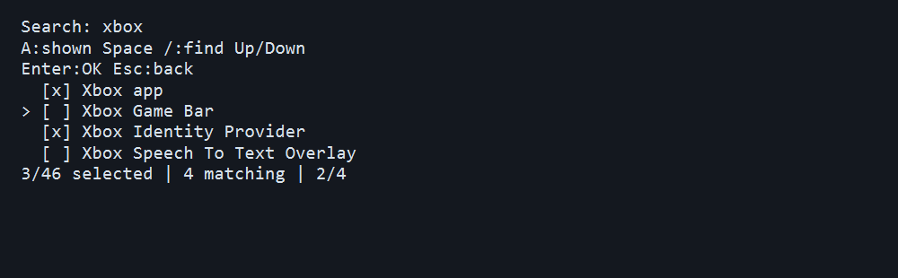

# XNebula

A focused Windows 11 debloating app that runs in **Windows PowerShell**. The compact, colored terminal menu provides six actions:

1. Remove Windows apps.
2. Disable optional services.
3. Apply supported privacy protections.
4. Disable Windows animations.
5. Force uninstall/delete Microsoft Edge.
6. Restore a settings backup.

Every change previews first. Type `APPLY` to proceed or press Enter to return. App and service lists use a checklist: **Up/Down** moves the cursor, **Space** toggles an item, **A** selects or clears all, **Enter** confirms, and **Esc** goes back. Only names are shown. Long lists scroll with the cursor. With redirected input, a numbered fallback accepts numbers, ranges, and `all`.

### Find, review, and correct your selection

Press **/** in an app or service checklist to search names, then type a filter. Search ignores case and supports Unicode. **Backspace** edits the filter; **Enter** finishes typing so you can navigate matches. **A** selects or clears only the matching rows while a filter is active. Previously checked items outside the filter stay checked, and the counter shows the total selection. **Esc** clears the search first; press it again to cancel. Enter with nothing selected keeps the checklist open and explains how to select or cancel.

At an app/service preview, type **EDIT** to return to the list with your checkmarks intact. The revised selection gets a new preview before APPLY. In the numbered fallback, editing displays previous choices with `[x]`: Enter keeps them, new numbers replace them, and `0` cancels. The menu announces app scanning and reports completion, failure, cancellation, or no changes to apply. Detailed errors and backup/log paths remain in the output.



This preview renders the terminal output with sample data; the running app retains your console theme.

Mistyping `APPLY` in the menu keeps your selection and asks again. Terminals without cursor controls, including `TERM=dumb`, use the numbered selector; `TERM=dumb` also disables color codes.

## Download and start

1. Download [xnebula-0.4.1-windows-x64.zip](https://github.com/glitchykid/xnebula/releases/download/v0.4.1/xnebula-0.4.1-windows-x64.zip) from the [release page](https://github.com/glitchykid/xnebula/releases/latest).
2. Extract the **entire ZIP** into a writable folder, such as Documents.
3. Open `Start-XNebula-Admin.cmd` and accept the Windows administrator prompt. `Start-XNebula.cmd` opens without elevation, but system-wide inventory and changes require administrator rights.

Python 3.15.2 is included. No separate Python installation, pip, Git, or network connection is required to run the portable app. Keep `.runtime`, `src`, and `scripts` alongside the launchers. The bundled release targets **Windows 11 x64, build 22000 or newer**. Windows 10/Server are outside the supported target; ARM64 developers can use the source installation with native Python.

Both launchers explicitly use built-in **Windows PowerShell 5.1**. They preserve your console theme. Menus use cyan, previews yellow, successes green, and failures red. Color output falls back to plain text when redirected or when `NO_COLOR` is present. Saved PowerShell profiles and system-wide console preferences are not edited. Launchers use a process-only execution-policy setting; organization-enforced script restrictions may still block them.

## Windows app removal

The app discovers removable Microsoft Appx/MSIX packages installed for existing accounts or provisioned for new accounts. This includes packages beyond the previous eight-app catalog: Photos, Store, App Installer/winget, Xbox, Teams, Copilot, Widgets, Outlook, Notepad, Paint, and others, depending on the machine. The keyboard checklist shows detected app names, with **A** to select or clear all.

Removal closes processes inside the selected app's installation directory and invokes Windows' package removal commands for all accounts and future-account provisioning. Frameworks, runtimes, Windows Security, the terminal host, protected SystemApps, and components required for sign-in/shell operation are excluded. Third-party desktop programs are outside this removal scope. Classic desktop software is not enumerated as Appx; Edge has a separate explicit action.

Optional media packages, including HEVC, HEIF, AV1, VP9, MPEG-2, Web Media, WebP, and Raw Image extensions, appear by readable names when installed and removable. Select them with Space or include them with A. These are codecs/format extensions, rather than inherently harmful software: removal can affect playback, image viewing, or thumbnails in applications using Windows codecs. See Microsoft's [codec documentation](https://support.microsoft.com/en-us/windows/apps/windowsmediaplayer/codecs-faq).

Save work before applying: force-closing selected apps can lose unsaved data. Removed app data and package installation media are **not** backed up. Selecting Store or App Installer can make later reinstallations harder; original signed packages, dependencies, licenses, or Windows installation media may be needed. A failed package is reported while the app attempts remaining removals, and the command returns failure if any removal failed.

```powershell
.\Start-XNebula-Admin.cmd scan
.\Start-XNebula-Admin.cmd remove all
.\Start-XNebula-Admin.cmd remove all --apply
# Individual IDs are shown by scan; existing aliases still work:
.\Start-XNebula-Admin.cmd remove news weather --apply
```

## Optional services

Services are **stopped and disabled**, preserving their registration so recovery remains possible. The optional list covers diagnostic telemetry, WAP push routing, error reporting, Remote Registry, retail demo, maps, location, Xbox services, media sharing, fax, search indexing, and printing.

The checklist shows service names; the action preview explains effects. Selecting all can disable printing/Print to PDF, Xbox sign-in/cloud saves/multiplayer, location, and media sharing, and make searches slower. These features may be useful on your PC; select only what you want disabled. Defender, Firewall, Windows Update, networking, sign-in, and other core services are not targets.

The app skips services required by running dependents outside the selected optional set. Selected dependents are stopped before their parent service; native operations recheck dependencies and do not force-stop unrelated services. Backups preserve startup mode, delayed automatic startup, and running/stopped state.

```powershell
.\Start-XNebula.cmd services list
.\Start-XNebula-Admin.cmd services disable all
.\Start-XNebula-Admin.cmd services disable DiagTrack WerSvc --apply
```

## Privacy and animations

The privacy action applies all **implemented, supported** protections: advertising ID, tailored/consumer suggestions, diagnostic collection limits, activity history publishing/upload, location, online speech, cross-device clipboard sync, Recall snapshots, packaged-app background activity, and packaged-app access to camera, microphone, contacts, calendars, email, messaging, tasks, call history, account information, and app diagnostics. Existing per-app allow/user-control policy exceptions are cleared when they would override a deny setting.

This is a finite set of Windows controls, not a promise that all network traffic or tracking by every application disappears. Diagnostic data is disabled on supported Enterprise/Education/IoT Enterprise editions and limited to required data on Pro. Unsupported edition/build settings are reported. Most policies require Pro/Enterprise/Education; Home does not support every policy. Domain/MDM settings can override local values. Policy verification confirms registry values, not every component's effective behavior.

Camera/microphone/background restrictions can stop calls, recording, syncing, and notifications. Recall policy application can cause Windows to delete existing snapshots; a settings backup cannot recover them. Most policies apply machine-wide, while tailored experiences and some suggestions apply to the account running the app. Running with another administrator account changes that account's user preferences.

Animation control disables Windows-managed UI effects, client-area animations, window minimize/restore, menu/tooltip animations and fades, smooth list scrolling, and taskbar animations **for the current account**. It persists and broadcasts preferences through `SystemParametersInfoW`; sign out if the taskbar still animates. Applications that implement their own animations may ignore these Windows preferences.

```powershell
.\Start-XNebula.cmd privacy list
.\Start-XNebula-Admin.cmd privacy set all --apply
.\Start-XNebula-Admin.cmd animations disable --apply
```

## Force Microsoft Edge removal

The explicit Edge action detects system-wide and current-account installations, verifies Microsoft signatures, closes only matching Edge browser processes, and runs the installed vendor uninstaller with force-uninstall arguments. If it leaves Edge installed, the confirmed action takes ownership/grants deletion access **only to the validated Edge Application directory** and force-deletes that directory. Junctions/symbolic links in that path or its contents cause refusal before recursive permission changes/deletion.

WebView2, Edge Update, third-party browsers, and browser profile data are outside the deletion target. The app reports **uninstalled** and **force-deleted files** separately. Forced file removal can leave an entry in Installed Apps or browser associations; Windows/Edge updates may restore the browser. Browser removal has no settings-backup undo—reinstall Edge to recover it. Access-denied, locked-file, and other failures are reported rather than claimed as success.

```powershell
.\Start-XNebula-Admin.cmd edge remove
.\Start-XNebula-Admin.cmd edge remove --apply
```

## Recovery, updating, and uninstalling XNebula

Automatic backups and JSONL action logs live in `.xnebula/logs` inside the extracted app folder, regardless of where the launcher was called. Menu option **6** lists backups by date and kind, so restoration needs no typed file path. Settings restore rejects conflicting later edits and skips already-restored values. Service restore restores prior configuration; animation restore restores captured preferences. Original registry backups from older releases remain accepted for known targets.

Backup rows include local time to the second and the filename to distinguish similar entries. The picker uses the recorded creation time when it includes a timezone, falling back to file modification time for legacy or invalid timestamps. Invalid or unreadable files are counted and skipped while readable backups remain available. Selecting a file still requires a successful restore preview; listing it does not validate its full recovery contents.

```powershell
.\Start-XNebula-Admin.cmd restore '.xnebula\logs\settings-EXAMPLE.json'
.\Start-XNebula-Admin.cmd restore '.xnebula\logs\settings-EXAMPLE.json' --apply
```

Backups are bound to machine ID and account SID and can contain local identifiers or old startup commands. Restore only trusted backups, newest-first when changes overlap. Settings/service backups do not contain deleted apps, app data, Recall snapshots, or Edge files. Keep original installation media and independent data backups when needed.

Changes are not an atomic transaction. Failures, interruptions, or timeouts can leave earlier work applied; an unfinished/uncertain journal action requires checking Windows state before retrying. Native deployment work may continue after a CLI timeout. Settings and service operations stop on errors; app package removal attempts remaining selected packages and reports failures.

Menu confirmation is bound to the reviewed plan. If relevant state changes before APPLY, the action stops and requires a new preview. Standalone app/Edge commands recheck inventory after typed confirmation. Settings, services and animations check captured state before writing; service/animation recovery retains the computed plan if the backup file is replaced while confirmation is open. Already-disabled animations need no confirmation or new backup. Registry changes reject duplicate targets, invalid values and unsupported schema types before writing. These checks reduce unintended changes; they do not make Windows mutations atomic. See the [runtime logic review](docs/reviews/logic-review-2026-11-03.md).

To update, extract the newer release into a new folder and retain/copy `.xnebula` backups as needed. To uninstall XNebula, retain needed backups and remove the extracted folder. Removing XNebula does not undo Windows changes. The previous profile, startup, storage-cleanup, background-picker, standalone Recall, and reports commands have been removed; Recall/background privacy controls are part of the privacy action and logging remains automatic.

Exit codes: `0` preview/completed/cancelled, `1` failure (including partial app removal), `2` invalid command line, `130` interrupted/closed input. No arguments open the menu in a terminal; redirected input displays help. `menu` explicitly opens the menu.

## Development and checks

Use full **Python 3.15.2** (latest stable verified 2026-11-03) with pip/venv for development. The embedded runtime is for running the app. There are no application runtime dependencies.

```powershell
git clone https://github.com/glitchykid/xnebula.git
Set-Location xnebula
py -3.15 -m venv .venv
.\.venv\Scripts\python.exe -m pip install -e '.[dev]'
Invoke-WebRequest -Uri https://www.python.org/ftp/python/3.15.2/python-3.15.2-embed-amd64.zip -OutFile "$env:TEMP\python-embed.zip"
.\.venv\Scripts\python.exe scripts/build_portable.py --runtime "$env:TEMP\python-embed.zip"
.\.venv\Scripts\python.exe -m ruff check .
.\.venv\Scripts\python.exe -m ruff format --check .
.\.venv\Scripts\python.exe -m unittest discover -s tests -v
.\.venv\Scripts\python.exe -m coverage run tests/run_tests.py
.\.venv\Scripts\python.exe -m coverage report
.\.venv\Scripts\python.exe -m build
```

Build the portable ZIP before tests to include extracted-launcher tests. The builder verifies the runtime against the SHA-256 on the [official Python 3.15.2 release page](https://www.python.org/downloads/release/python-3152/), includes Python's license, and produces a ZIP checksum. Packaging excludes local runtimes, developer tools, profiles, and backups. Wheels/source archives are also in `dist/`; use `python -m build --no-isolation` when the pinned backend is already installed. Formatting: `python -m ruff format .`.

`unittest` is the runner; combined statement/branch coverage must be at least **90%**, enforced by `coverage report`. Windows CI builds the ZIP and runs lint, formatting, coverage, and package builds. Native adapters are tested with substitute service/Appx/Edge cmdlets and an in-memory Windows preference API. **Tests do not delete host apps, stop host services, or alter host privacy/animation preferences.** Real UAC approval, native destructive operations, effective policies, and visual console rendering still need manual validation in an elevated disposable Windows VM.

Pinned development/build tools: Ruff 0.17.2, Coverage.py 7.17.0, build 1.6.1, Hatchling 1.32.4. OS integration uses built-in Windows PowerShell 5.1 and documented Windows APIs.

## Layout

```text
src/xnebula/       CLI/menu, Windows app discovery, services, privacy,
                   animations, Edge removal, console colors, and recovery
tests/             unit tests, native adapter tests, extracted launcher tests
scripts/           PowerShell launcher and portable ZIP builder
docs/wiki/         versioned operation/policy/recovery documentation
docs/releases/     milestone release notes
.github/workflows/ Windows CI
Start-XNebula*.cmd standard and administrator launchers
START-HERE.txt     portable quick start
pyproject.toml     package, tooling, and coverage configuration
```

See the [wiki](docs/wiki/Home.md), [policy details](docs/wiki/Policies.md), and [v0.4.1 release notes](docs/releases/v0.4.1.md). `AGENTS.md` remains unchanged.
